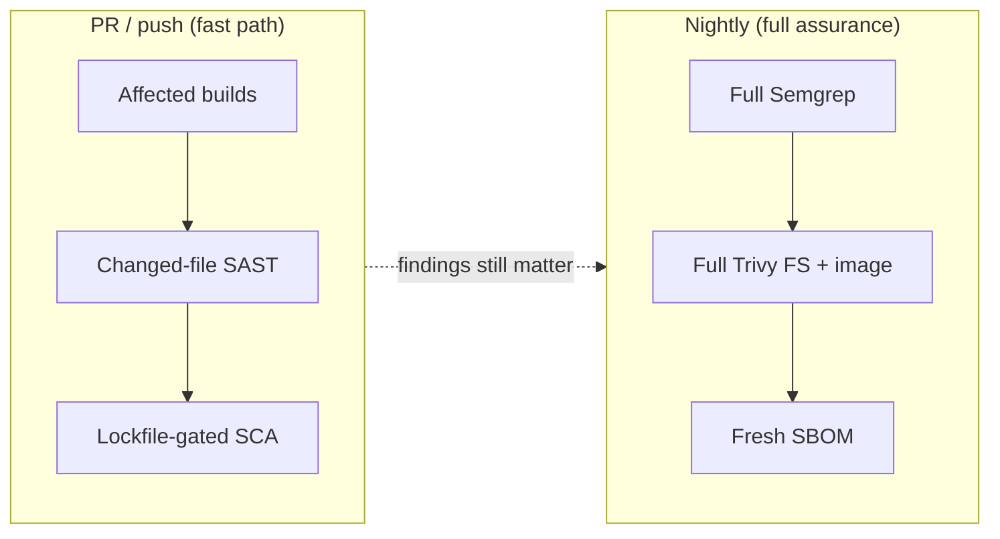
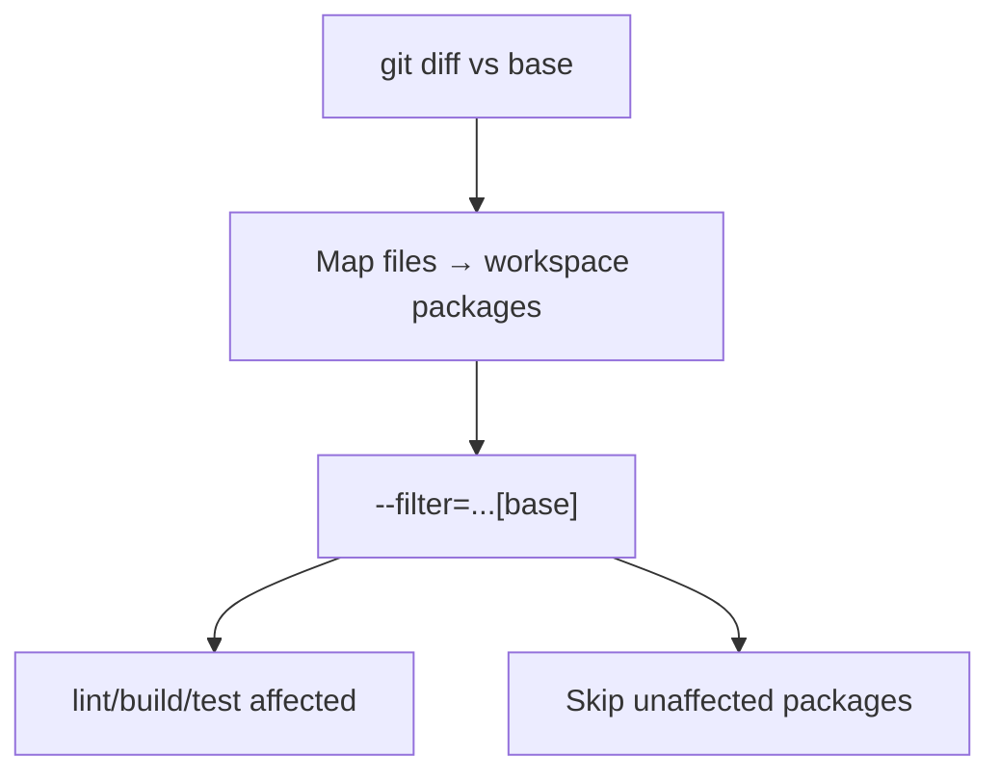
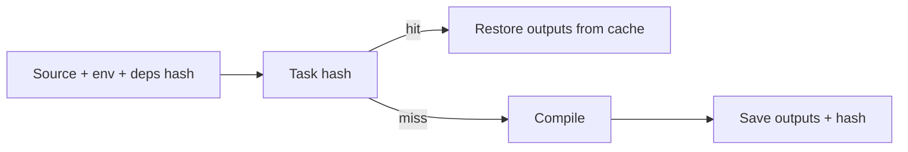
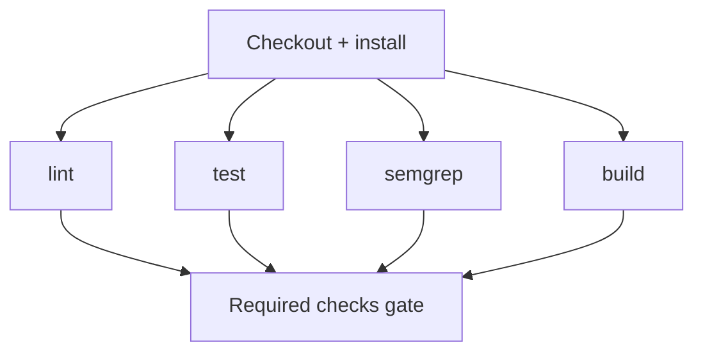
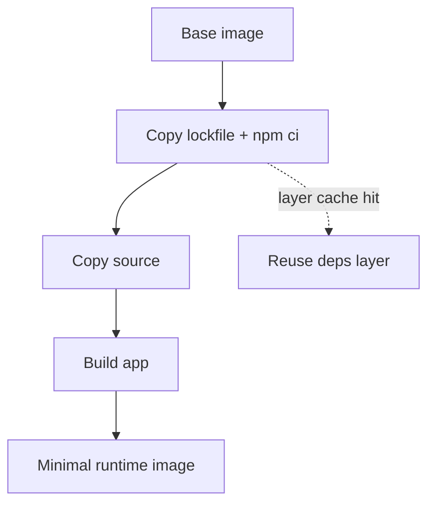
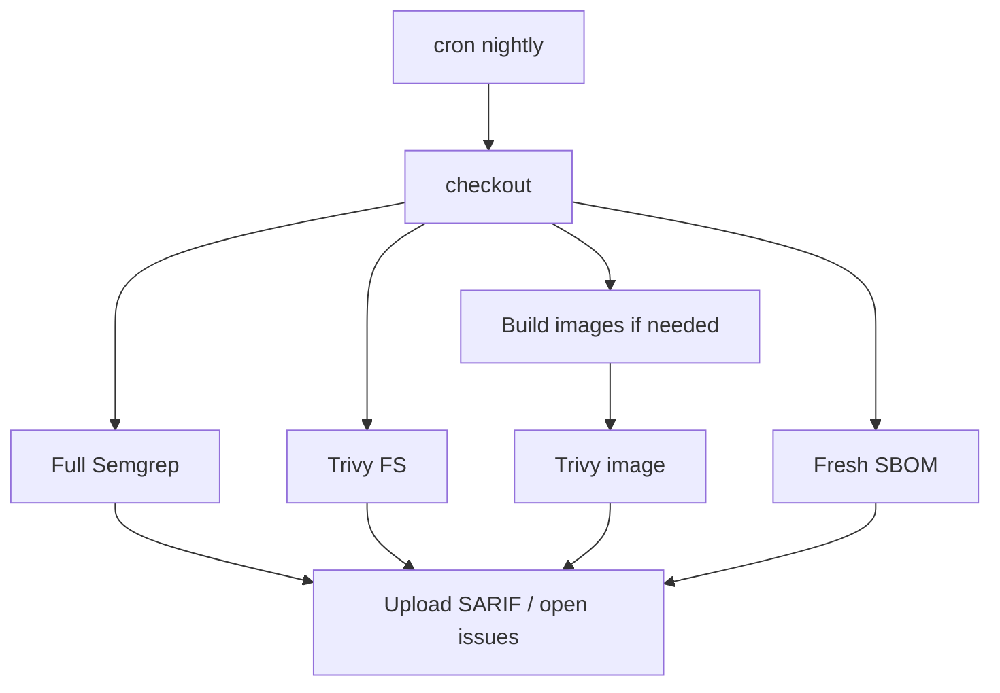
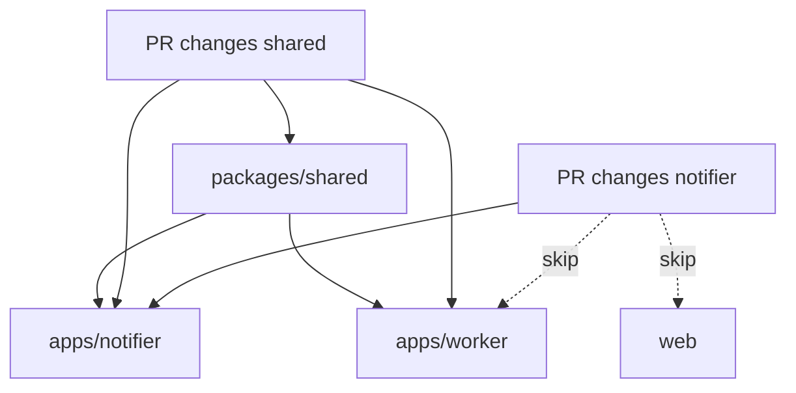
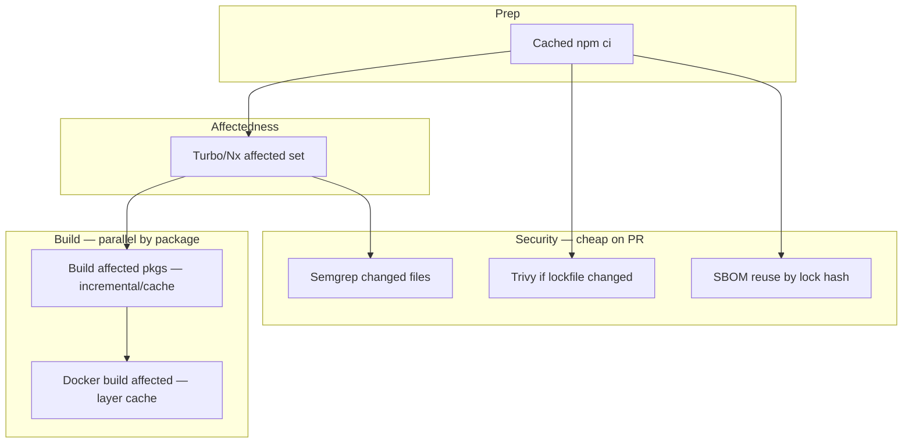

# DevSecOps CI/CD Optimizations — A Practical Guide

A field guide to making monorepo CI **fast without lying to yourself about security**.  
Written against the Convixa playground (`docs/ci-playground/`, Turborepo + npm workspaces), but the patterns apply to Nx, Bazel, and most GitHub Actions setups.

---

## Table of contents

1. [The core tension](#1-the-core-tension)
2. [Mental model: what CI actually spends time on](#2-mental-model-what-ci-actually-spends-time-on)
3. [Technique 1 — Change detection](#3-technique-1--change-detection)
4. [Technique 2 — Incremental builds](#4-technique-2--incremental-builds)
5. [Technique 3 — Parallel independent jobs](#5-technique-3--parallel-independent-jobs)
6. [Technique 4 — Cache dependency installation](#6-technique-4--cache-dependency-installation)
7. [Technique 5 — Cache build artifacts](#7-technique-5--cache-build-artifacts)
8. [Technique 6 — Docker layer caching](#8-technique-6--docker-layer-caching)
9. [Technique 7 — Semgrep on changed files (PRs)](#9-technique-7--semgrep-on-changed-files-prs)
10. [Technique 8 — Trivy with lockfile skip](#10-technique-8--trivy-with-lockfile-skip)
11. [Technique 9 — Syft SBOM reuse by dependency hash](#11-technique-9--syft-sbom-reuse-by-dependency-hash)
12. [Technique 10 — Nightly full security suite](#12-technique-10--nightly-full-security-suite)
13. [Technique 11 — Dependency-graph skip (Turbo/Nx/Bazel)](#13-technique-11--dependency-graph-skip-turbonxbazel)
14. [Benchmarking discipline](#14-benchmarking-discipline)
15. [How the pieces compose](#15-how-the-pieces-compose)
16. [Local execution without pushing](#16-local-execution-without-pushing)
17. [Cheat sheet](#17-cheat-sheet)

---


## 1. The core tension

Every CI optimization is a bet:

> **Skip or reuse work** ↔ **still catch regressions and vulns before merge/deploy**


| If you optimize…     | You risk…                           | You recover guarantees via…                         |
| -------------------- | ----------------------------------- | --------------------------------------------------- |
| Building less        | Shipping a broken dependent package | Accurate package graph + rebuild dependents         |
| Scanning less on PRs | Missing a vuln in untouched code    | Nightly full scans + blocking on new findings       |
| Caching more         | Stale/poisoned artifacts            | Content-hashed keys + cache bust on lockfile change |


**Rule of thumb:** PR pipelines optimize for *developer speed on the diff*. Nightly/main pipelines optimize for *full assurance*.




---


## 2. Mental model: what CI actually spends time on

Typical monorepo wall-clock (rough order):

```text
┌─────────────────────────────────────────────────────────┐
│  npm/pnpm install          ████████░░░░  15–40%         │
│  compile / next build      ████████████  30–50%         │
│  tests                     ████░░░░░░░░  10–25%         │
│  docker build              ██████░░░░░░  10–30%         │
│  security scanners         ███░░░░░░░░░   5–20%         │
└─────────────────────────────────────────────────────────┘
```

Optimizations map to those bars:


| Technique                           | Hits which bar?                        |
| ----------------------------------- | -------------------------------------- |
| Change detection / graph skip       | compile, test, per-service docker/scan |
| Incremental builds + artifact cache | compile                                |
| Dep install cache                   | install                                |
| Parallel jobs                       | wall-clock across independent bars     |
| Docker layer cache                  | docker                                 |
| Conditional Semgrep/Trivy/Syft      | security scanners                      |


---


## 3. Technique 1 — Change detection


### What it is

Only run lint/build/test for packages whose **source changed** since a base ref (e.g. `origin/main`), instead of the whole monorepo.

In this repo (Turborepo):

```bash
# Demo: pretend only notifier changed
npx turbo run build --filter='@convixa/notifier...'

# Real: packages changed vs main (turbo uses git under the hood)
npx turbo run build --filter='...[origin/main]'
```

You do **not** need to call `git diff` yourself when using Turbo’s `[ref]` filter — Turbo maps the diff → packages.

### Execution flow




### Why it reduces CI time

You avoid the expensive work for untouched apps (here: skipping Next.js when only `apps/notifier` changed — often saving tens of seconds to minutes).

### Security guarantees that remain

- **Build correctness** remains if the dependency graph is accurate: changing `packages/shared` must rebuild dependents (`...@convixa/shared` style filters).
- **Security scanning of unchanged code is deferred** — pair with nightly full SAST/SCA (Technique 10).


### Trade-offs


| Upside                                | Downside                                                     |
| ------------------------------------- | ------------------------------------------------------------ |
| Huge wins on narrow PRs               | Wrong package boundaries → false skips                       |
| Easy to reason about with `--dry-run` | Repo-wide / lockfile / CI-config changes still rebuild a lot |
| Works locally                         | Does not speed up install by itself                          |


### Local in this playground

```bash
npm run ci:baseline
CI_CHANGED_SCOPE=notifier npm run ci:change-detection
npm run ci:benchmark -- \
  docs/ci-playground/benchmarks/baseline.json \
  docs/ci-playground/benchmarks/01-change-detection.json
```

---


## 4. Technique 2 — Incremental builds


### What it is

Compilers reuse prior work:

- TypeScript / `tsc` incremental (`tsconfig` `incremental`, `.tsbuildinfo`)
- Next.js `.next/cache`
- Turbo **local task cache** (hash inputs → reuse `dist/` / `.next` outputs)
- Bazel remote execution / Nx computation cache (same idea, different product)

Difference from change detection:


|           | Change detection      | Incremental builds                              |
| --------- | --------------------- | ----------------------------------------------- |
| Question  | *Which packages run?* | *Within a package, can we reuse prior compile?* |
| Skip unit | Whole package tasks   | File/module-level or task-hash cache hit        |


### Execution flow




### Why it reduces CI time

Warm PRs that touch a few files in an already-built package avoid full recompiles.

### Security guarantees

- Cache hits are safe **if the hash includes everything that affects output** (env vars like `NEXT_PUBLIC_`*, lockfile, toolchain version). Missing inputs → **silent wrong artifacts**.
- Does not replace tests or scanners.


### Trade-offs

- Cache poisoning / stale hits if hash inputs are incomplete.
- First run (cold cache) still slow — measure warm *and* cold.
- In learning labs, use `--force` when you want to isolate *change detection* from *cache hits*.

---


## 5. Technique 3 — Parallel independent jobs


### What it is

Split the pipeline into jobs that don’t need each other’s outputs, and run them concurrently on separate runners (or `strategy.matrix`).

Examples:

- `lint` ∥ `unit-test` ∥ `semgrep` ∥ `build-web`
- matrix: build each affected service image in parallel


### Execution flow




### Why it reduces CI time

Wall-clock ≈ max(job times), not sum — when jobs are independent and runners are available.

### Security guarantees

- Unchanged: each check still runs; you only change *scheduling*.
- Be careful: a “green” parallel graph can still merge if required checks aren’t all marked required in branch protection.


### Trade-offs

- More runners = more $ / queue contention.
- Over-parallelizing tiny jobs adds setup overhead (checkout/install per job) — often share an install artifact or use a reusable workflow.
- Ordering still matters for deploy: build → scan image → push.

---


## 6. Technique 4 — Cache dependency installation


### What it is

Reuse `node_modules` / npm/pnpm store across CI runs when the lockfile is unchanged.

GitHub Actions:

```yaml
- uses: actions/setup-node@v4
  with:
    node-version: "20"
    cache: npm          # keys off package-lock.json
- run: npm ci
```

Or explicit `actions/cache` on `~/.npm` / pnpm store with key:

```text
${{ runner.os }}-npm-${{ hashFiles('**/package-lock.json') }}
```


### Why it reduces CI time

Skips re-downloading hundreds of MB when dependencies didn’t change — often the #1 win after “don’t build everything.”

### Security guarantees

- **Same lockfile ⇒ same resolved graph** (with `npm ci`). You are not skipping vulnerability *existence*; you’re skipping *re-download*.
- Still run SCA when the lockfile **does** change (Technique 8).
- Prefer `npm ci` in CI (strict lockfile) over `npm install`.


### Trade-offs

- Cache restore can still take time; broken caches need bust keys.
- Don’t cache `node_modules` across radically different OS/arch without including that in the key.
- Private registry auth must still work on cache miss.

---


## 7. Technique 5 — Cache build artifacts


### What it is

Persist compile outputs between runs:

- Turbo/Nx remote cache
- `actions/cache` on `.next/cache`, `**/dist`, `**/.tsbuildinfo`
- GHA cache for Docker buildx (overlaps Technique 6)

Key by: lockfile hash + source hash + relevant env.

### Why it reduces CI time

Turns “rebuild package” into “download tarball of last outputs” when inputs match.

### Security guarantees

- Same as incremental builds: **hash completeness is the security boundary** for correctness.
- Treat remote build caches like an artifact registry: access control, no untrusted PR writers to shared write caches (read-only cache for fork PRs is a common policy).


### Trade-offs

- Remote cache write from forks = supply-chain risk.
- Large caches = storage cost / eviction thrash.
- Debugging “works locally, fails in CI” gets harder — always have a `--force` / empty-cache escape hatch.

---


## 8. Technique 6 — Docker layer caching


### What it is

Docker builds as stacked layers. Reorder Dockerfile so **rarely changing layers** (deps) come before **often changing layers** (app source). Persist layers via:

- BuildKit cache mounts (`RUN --mount=type=cache`)
- `cache-from` / `cache-to` type=gha / registry

This repo’s root `Dockerfile` already uses BuildKit mounts for npm and Next cache; `build-push.yml` uses:

```yaml
cache-from: type=gha
cache-to: type=gha,mode=max
```


### Execution flow




### Why it reduces CI time

Unchanged `package-lock.json` → reuse dependency layer (often minutes saved). Source-only changes rebuild from the `COPY . .` layer downward only.

### Security guarantees

- Cached layers are not a vuln scan. Still scan final images (Trivy) on a cadence.
- Pin base image digests/tags carefully — floating `latest` invalidates *and* drifts security posture.


### Trade-offs

- Bad layer ordering destroys cache hit rates.
- `mode=max` caches intermediate layers (faster builds, larger cache).
- BuildKit cache mounts on a single builder ≠ shared across ephemeral GHA runners unless you export to GHA/registry cache.

---


## 9. Technique 7 — Semgrep on changed files (PRs)


### What it is

**Semgrep** = SAST (static analysis). On PRs, scan only files touched in the PR to keep feedback fast.

Conceptual Actions shape:

```yaml
- uses: actions/checkout@v4
  with:
    fetch-depth: 0
- uses: semgrep/semgrep-action@v1   # or docker run semgrep/semgrep
  with:
    # config: p/ci, p/security-audit, custom rules
# Or CLI:
# semgrep scan --baseline-commit origin/main
```

`--baseline-commit` / changed-path filters focus findings on the diff.

### Why it reduces CI time

Full-repo Semgrep on a large codebase can dominate PR time; diff-scoped scans finish in seconds–minutes.

### Security guarantees that remain


| Still covered on PR                 | Not fully covered on PR                           |
| ----------------------------------- | ------------------------------------------------- |
| New issues introduced by the diff   | Pre-existing issues in untouched files            |
| Rules you enabled for the PR config | Deep/expensive rule packs you deferred to nightly |


**Compensating control:** nightly full Semgrep (Technique 10) + triage into issues/Slack; optionally fail main on new regressions.

### Trade-offs

- Cross-file issues can need more than the changed file set (Semgrep handles some interfile; know your rules).
- “Only changed files” can miss a vuln activated by a config change elsewhere — include config/lockfile/CI paths as always-scan.

---


## 10. Technique 8 — Trivy with lockfile skip


### What it is

**Trivy** scans:

- Filesystem / repo (deps, misconfigs, secrets)
- Container images (OS + app vulns)

**Skip when lockfiles unchanged:**

```bash
if git diff --name-only origin/main...HEAD | grep -Eq 'package-lock.json|pnpm-lock.yaml'; then
  trivy fs --severity .
else
  echo "Lockfile unchanged — skip Trivy FS SCA on PR"
fi
```

Still run image scans when Dockerfiles/app layers that affect the image changed — or defer image scan to post-build of affected services only.

### Why it reduces CI time

SCA DB download + full FS scan is heavy; most PRs don’t change dependencies.

### Security guarantees that remain


| PR                                          | Nightly                                            |
| ------------------------------------------- | -------------------------------------------------- |
| SCA when lockfile changes                   | Full FS + image scan                               |
| Optional: scan only affected service images | Catch newly published CVEs against *old* lockfiles |


**Critical insight:** skipping SCA on an unchanged lockfile is OK for “did this PR add a bad dep?” but **CVE databases change daily**. That’s why nightly rescans of the same lockfile still matter.

### Trade-offs

- Skip logic must list *all* lockfiles (npm, pnpm, yarn, go.sum, Cargo.lock, …).
- Misconfigured skip → false confidence.
- Severity gates (fail on CRITICAL) need agreed policy.

---


## 11. Technique 9 — Syft SBOM reuse by dependency hash


### What it is

**Syft** generates an **SBOM** (Software Bill of Materials) — inventory of packages in a dir/image.

Reuse strategy:

```bash
HASH=$(sha256sum package-lock.json | awk '{print $1}')
# If artifact sbom-$HASH.json exists in cache/release → reuse
# Else syft dir:. -o spdx-json > sbom-$HASH.json
```

Same idea keyed by `hashFiles('**/package-lock.json')` in Actions cache.

### Why it reduces CI time

SBOM generation walks the whole dependency tree / image; skipping when the inventory *cannot* have changed saves minutes on busy repos.

### Security guarantees that remain

- SBOM identity is tied to the dependency hash — correct for “what’s in the dep graph.”
- Does **not** mean “no new CVEs”; CVEs are about *known issues in those packages*, which change over time → re-scan with Trivy/Grype nightly even when SBOM is reused.
- For images, hash should include base image digest + lockfile + Dockerfile inputs that affect installed packages.


### Trade-offs

- Wrong hash inputs → stale SBOM (compliance risk).
- Consumers (customers, auditors) may require fresh generation on every release regardless — reuse is often for PR CI, not release artifacts.

---


## 12. Technique 10 — Nightly full security suite


### What it is

A scheduled workflow (`on: schedule: cron: ...`) that does **not** skip:

- Full Semgrep (all rules you care about)
- Full Trivy filesystem scan
- Full container image scan(s)
- Fresh Syft SBOM (ignore reuse)


### Execution flow




### Why it “reduces CI time” (indirectly)

It doesn’t speed the nightly job — it **allows PR jobs to be aggressive about skipping** while still converging on assurance within 24h.

### Security guarantees

This is the **backbone** of the fast-PR model:

- New CVEs against existing deps
- Drift / latent SAST issues
- Image OS vulns after base image rebuilds
- Audit-ready fresh SBOM


### Trade-offs

- Findings arrive *after* merge unless you also gate release trains.
- Alert fatigue if severity isn’t triaged.
- Need owners on-call for nightly red builds.

---


## 13. Technique 11 — Dependency-graph skip (Turbo/Nx/Bazel)


### What it is

Change detection’s smarter cousin: use the **package dependency graph** so that:

- Changing a leaf service → build/scan only that service
- Changing a shared lib → build/scan **all dependents**
- Changing unrelated service B → skip service A entirely (build *and* container scan)


| Tool      | Mechanism                                          |
| --------- | -------------------------------------------------- |
| Turborepo | `--filter` + `dependsOn: ["^build"]` + git filters |
| Nx        | `nx affected -t build`                             |
| Bazel     | fine-grained graph, only rebuild requested targets |


Also apply the same affected set to:

- Docker builds per service
- Trivy image scans
- Deploy matrices


### Execution flow




### Why it reduces CI time

In a repo with N microservices, most PRs touch O(1) services — graph-aware CI scales as O(affected), not O(N).

### Security guarantees

- Same as change detection: **graph accuracy is everything**.
- Always-on paths: root CI config, shared IaC, lockfiles → treat as “affects all.”
- Nightly still scans all images.


### Trade-offs

- Implicit deps (runtime string imports, pub/sub contracts) won’t appear in the build graph — document and force-include those edges.
- Bazel is most precise; Turbo/Nx are usually enough for JS monorepos.

---


## 14. Benchmarking discipline

Without numbers, “faster CI” is folklore.

**Per optimization:**

1. Record cold baseline (or previous step JSON).
2. Apply **one** change.
3. Record again (warm *and* cold if caching is involved).
4. Print delta:

```text
phase        before    after    saved    improve
total          41s      12s      29s     70.7%
```

This playground:

```bash
npm run ci:baseline
npm run ci:change-detection   # after implementing a step
npm run ci:benchmark -- before.json after.json
```

**Tips:**

- Isolate variables (`--force` when measuring filters, not caches).
- Document flags in the JSON (`change_detection: true`, …).
- Compare apples to apples (same `SKIP_WEB_*`, same machine).

---


## 15. How the pieces compose

Recommended layering (PR pipeline):




Nightly = same graph, **no skips**, full scanners, fresh SBOM.

---


## 16. Local execution without pushing


| Approach                               | Use when                                      |
| -------------------------------------- | --------------------------------------------- |
| `scripts/ci/*.sh` + `npm run ci:*`     | Fastest learning loop (this repo)             |
| `[act](https://github.com/nektos/act)` | Validate actual `.github/workflows/*` locally |
| `turbo run … --dry-run`                | Inspect affected set without building         |
| `docker buildx build --cache-to=…`     | Practice layer caching locally                |


Example act:

```bash
brew install act
act -W .github/workflows/ci-playground.yml -j baseline
```

---


## 17. Cheat sheet


| #   | Technique          | PR behavior                         | What nightly restores             |
| --- | ------------------ | ----------------------------------- | --------------------------------- |
| 1   | Change detection   | Build affected packages             | —                                 |
| 2   | Incremental builds | Reuse compile when hash matches     | Cold rebuilds / cache flush       |
| 3   | Parallel jobs      | Independent checks concurrently     | —                                 |
| 4   | Dep install cache  | Skip re-download on same lockfile   | Clean install verification        |
| 5   | Artifact cache     | Restore `dist`/.next                | Full rebuild                      |
| 6   | Docker layer cache | Reuse dep layers                    | Rebuild from scratch periodically |
| 7   | Semgrep diff       | Changed files only                  | Full Semgrep                      |
| 8   | Trivy skip         | Skip if lockfile unchanged          | Full FS + image (new CVEs)        |
| 9   | Syft reuse         | Reuse SBOM on same dep hash         | Fresh SBOM                        |
| 10  | Nightly suite      | —                                   | Full assurance spine              |
| 11  | Graph skip         | Skip unrelated services’ build+scan | Scan all services                 |


### One-sentence policy

> **PRs prove the diff is safe and the graph still builds; nightlies prove the product is still safe against a moving threat landscape.**

---


## Mapping to this repository


| Already in playground                                                  | Still conceptual / next to implement          |
| ---------------------------------------------------------------------- | --------------------------------------------- |
| Workspaces + Turbo graph (`apps/*`, `packages/shared`)                 | Incremental turbo cache as measured step      |
| `ci:baseline`, `ci:change-detection`, `ci:benchmark`                   | Parallel GHA jobs                             |
| Root Dockerfile BuildKit mounts + GHA docker cache in `build-push.yml` | Semgrep / Trivy / Syft workflows              |
| Docs for Step 0–1                                                      | Nightly workflow + affected matrix for images |


Hands-on entry points:

- `docs/ci-playground/STEP-00-baseline.md`
- `docs/ci-playground/STEP-01-change-detection.md`
- `scripts/ci/run-baseline.sh`
- `scripts/ci/run-change-detection.sh`

---


## Further reading

- Turborepo filtering: [https://turbo.build/repo/docs/crafting-your-repository/running-tasks#using-filters](https://turbo.build/repo/docs/crafting-your-repository/running-tasks#using-filters)  
- GitHub Actions cache: [https://docs.github.com/en/actions/using-workflows/caching-dependencies-to-speed-up-workflows](https://docs.github.com/en/actions/using-workflows/caching-dependencies-to-speed-up-workflows)  
- Docker BuildKit cache: [https://docs.docker.com/build/cache/](https://docs.docker.com/build/cache/)  
- Semgrep CI: [https://semgrep.dev/docs/semgrep-ci/overview](https://semgrep.dev/docs/semgrep-ci/overview)  
- Trivy: [https://trivy.dev/](https://trivy.dev/)  
- Syft / SBOM: [https://github.com/anchore/syft](https://github.com/anchore/syft)

