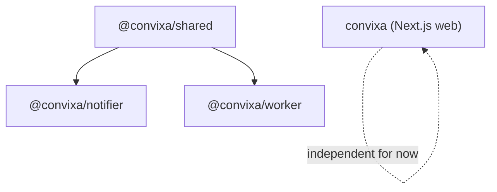
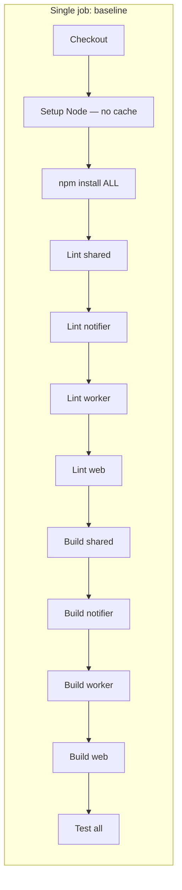

# CI Playground — Step 0: Foundation & Baseline

## What we found

This repo was a **single Next.js app** (`convixa`), not a multi-package monorepo.
Goals like “only build affected projects” and “skip unaffected microservices”
need a real package graph. So Step 0 establishes that graph **without** changing
how the existing web app / Docker deploy path works.

## What we added

| Path | Role |
|------|------|
| `packages/shared` | Shared health/log helpers (`@convixa/shared`) |
| `apps/notifier` | Tiny HTTP notify service (`@convixa/notifier`) |
| `apps/worker` | Tiny heartbeat worker (`@convixa/worker`) |
| `turbo.json` | Task graph (build/lint/test) for later filters |
| `scripts/ci/run-baseline.sh` | Local “full CI” simulation + timing JSON |
| `scripts/ci/benchmark.sh` | Diff two timing JSONs and print % improvement |
| `.github/workflows/ci-playground.yml` | Unoptimized GitHub Actions baseline |
| `docs/ci-playground/` | Learning notes + benchmark artifacts |

Root `package.json` now declares npm **workspaces** (`apps/*`, `packages/*`).
The existing production workflow `build-push.yml` is left untouched.

## Package dependency graph



## Baseline execution flow (intentionally slow)



## Why this is the baseline

- **No change detection** — every PR rebuilds every package.
- **No incremental builds** — TypeScript/`next` caches are not reused across runs.
- **No parallelism** — one job, sequential steps.
- **No dependency/artifact cache** in Actions.
- **No security scanners yet** — those arrive in later steps.

## Security guarantees at this stage

None beyond whatever you already run locally. The baseline is a **timing
reference**, not a security gate. Nightly full scans come in Step 10.

## Trade-offs of this foundation

| Upside | Downside |
|--------|----------|
| Realistic multi-package graph for learning | Extra packages are playground stubs, not product features |
| Existing Docker deploy path unchanged | Root is both workspace root and the web app (slightly unusual) |
| Local scripts work without GitHub | Full web build is slow; use `SKIP_WEB_BUILD=1` for fast demos |

## Run locally

```bash
# Fast playground demo (skip Next.js build — still exercises the graph)
SKIP_WEB_BUILD=1 SKIP_WEB_LINT=1 npm run ci:baseline

# Full baseline (includes Next.js build — needs valid env for next build)
npm run ci:baseline

# Later: compare two steps
npm run ci:benchmark -- docs/ci-playground/benchmarks/baseline.json \
  docs/ci-playground/benchmarks/01-change-detection.json
```

Optional: install [`act`](https://github.com/nektos/act) to run the workflow file locally:

```bash
brew install act
act -W .github/workflows/ci-playground.yml -j baseline
```

## Next optimization

**Step 1 — Change detection:** only build packages affected by the git diff
(using Turborepo `--filter=...[origin/main]`).
