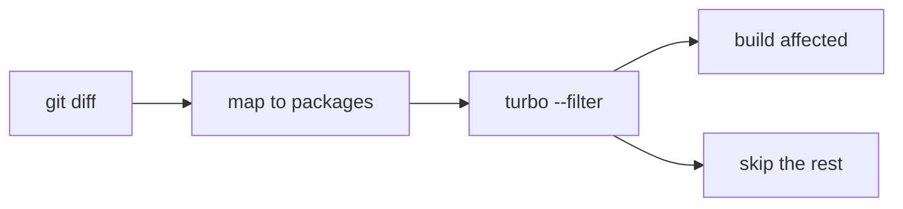

# Step 1 — YOUR assignment: Change Detection

> Agent role: explain + sketch. **You write the code.** Then re-run.

## Concept

Baseline always builds every package. Change detection builds only packages
touched by the current change (plus their dependencies).

```text
git diff  →  which files changed?
Turborepo →  which packages own those files?
turbo run →  lint/build/test ONLY those packages
```



## Why this saves time

Skipping the Next.js web build when a PR only touches `apps/notifier` is the
big win (~30s+ of your ~41s baseline).

## Security / trade-offs

- Unaffected packages are not re-validated on this PR (OK if the graph is correct).
- If `packages/shared` changes, dependents must rebuild too.
- Does **not** speed up `npm install` yet (that’s Step 4).
- Use `--force` for now so Turbo’s *task cache* doesn’t hide the win (Steps 2/5).

## Filter cheat-sheet (this repo’s Turbo 2.x)

Try these dry-runs yourself before writing the script:

```bash
npx turbo run build --filter='@convixa/notifier...' --dry-run
# expect: shared + notifier

npx turbo run build --filter='...@convixa/shared' --dry-run
# expect: shared + notifier + worker

npx turbo run build --filter='//' --dry-run
# expect: root web app only
```

| Filter | Meaning here |
|--------|----------------|
| `@convixa/notifier...` | notifier + **dependencies** |
| `...@convixa/shared` | shared + **dependents** |
| `...[origin/main]` | packages changed vs that git ref |

---

## What to create

### 1. `scripts/ci/run-change-detection.sh`

Make it executable (`chmod +x`). Structure:

```bash
#!/usr/bin/env bash
set -euo pipefail
ROOT_DIR="$(cd "$(dirname "${BASH_SOURCE[0]}")/../.." && pwd)"
cd "$ROOT_DIR"

STEP_NAME="${CI_STEP_NAME:-01-change-detection}"
RESULTS_DIR="${ROOT_DIR}/docs/ci-playground/benchmarks"
mkdir -p "$RESULTS_DIR"

# TODO: copy timing helpers from run-baseline.sh (ts, elapsed)
# TODO: resolve TURBO_FILTER:
#   - if CI_CHANGED_SCOPE=notifier  →  @convixa/notifier...
#   - if CI_CHANGED_SCOPE=worker    →  @convixa/worker...
#   - if CI_CHANGED_SCOPE=shared    →  ...@convixa/shared
#   - if CI_CHANGED_SCOPE=web       →  //
#   - else                          →  ...[${CI_BASE_REF:-origin/main}]
# TODO: print included vs skipped packages (like the baseline banner)
# TODO: npx turbo run build --filter="$TURBO_FILTER" --dry-run   # learn from this
# TODO: time: npm install
# TODO: time: npx turbo run lint  --filter="$TURBO_FILTER" --force
# TODO: time: npx turbo run build --filter="$TURBO_FILTER" --force
# TODO: time: npx turbo run test  --filter="$TURBO_FILTER" --force
# TODO: write JSON to $RESULTS_DIR/$STEP_NAME.json  (same shape as baseline.json)
#       set "change_detection": true in flags
```

Use `run-baseline.sh` as your template for timing + JSON output. Don’t invent a
new format — `ci:benchmark` expects the same `seconds` keys.

### 2. `package.json` script

Add next to `ci:baseline`:

```json
"ci:change-detection": "bash scripts/ci/run-change-detection.sh"
```

### 3. (Optional) workflow job

In `.github/workflows/ci-playground.yml`, add a job that runs your script with
`fetch-depth: 0` (git history needed for real filters). Not required for the
local learning loop.

---

## How to verify

```bash
# Simulate a notifier-only PR (skips web + worker)
CI_CHANGED_SCOPE=notifier npm run ci:change-detection

# Compare to your full baseline
npm run ci:benchmark -- \
  docs/ci-playground/benchmarks/baseline.json \
  docs/ci-playground/benchmarks/01-change-detection.json
```

**Success looks like:** dry-run shows only `shared` + `notifier`, total time
much lower than baseline (~41s), mostly because web was skipped.

When you’re done, paste the banner + benchmark output and we’ll review, then
move to Step 2 (you write again).
